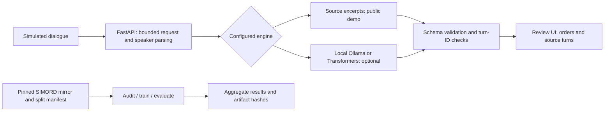

# CareTrace

**Clinical order extraction with inspectable source evidence.**

[](https://github.com/Stark2028/caretrace/actions/workflows/checks.yml)
[](LICENSE)

[Live workspace](https://caretrace.65.0.103.235.sslip.io) · [API docs](https://caretrace.65.0.103.235.sslip.io/docs) · [Measured results](RESULTS.md) · [Research method](docs/METHODOLOGY.md)

CareTrace turns simulated consultation text into candidate medication, laboratory, imaging, and follow-up orders, then lets a reviewer inspect the associated conversation turns. It pairs a lightweight deployed application with local language-model experiments, dataset auditing, and frozen evaluation protocols.

> **Research prototype.** Extraction quality is limited and evidence annotations have known problems. Use invented or public simulated dialogue only. This project has not been validated for patient care and does not diagnose or prescribe.


## Why this project

A clinical documentation pipeline needs to distinguish a current clinician action from patient history, a hypothetical plan, or a declined treatment. Well-formed JSON alone cannot make that distinction. CareTrace studies that problem through [MEDIQA-OE](https://aclanthology.org/2025.clinicalnlp-1.2/)-inspired order extraction and makes its failure modes visible.

The public demo uses a **source-preserving extractor**: its descriptions are literal conversation excerpts and its reason field is always null. It avoids generated descriptions in this mode, but can still misunderstand intent, miss orders, or assign the wrong type. Local Qwen model adapters support a separate generative research comparison.

## Try the workflow

1. Open the [workspace](https://caretrace.65.0.103.235.sslip.io) and select **Load example**.
2. Select **Extract orders**. The engine badge identifies the active method.
3. Select **Turn 2** or another evidence link to inspect its source.
4. Mark a candidate **Accept** or **Flag for review**. Marks exist only in page memory.
5. Edit the transcript: old results and review marks are cleared to avoid stale evidence.

An evidence link proves that a turn exists, **not that it supports the proposed order**. No output is automatically written to an EHR or treated as an approved order.

## What was measured

Scores below are percentages from a **lexical matching proxy**, not clinical accuracy or the official MEDIQA-OE metric.

| Frozen experiment | Encounters | Precision | Recall | F1 proxy | Input/output failures |
| --- | ---: | ---: | ---: | ---: | ---: |
| Rules baseline, test2 | 92 | 0.00 | 0.00 | 0.00 | 4 |
| Local Qwen2.5 7B, test2 | 92 | 15.65 | 21.20 | 18.00 | 5 |
| Rules baseline, test1 | 90 | 0.00 | 0.00 | 0.00 | 0 |
| Source extractor, test1 | 90 | 17.47 | 12.83 | 14.80 | 0 |

These are weak absolute results against a weak baseline. Test1 and test2 are different sets; the table does **not** establish a ranking between the source extractor and 7B model. A small-model partial fine-tuning experiment also failed to demonstrate extraction improvement. All are retained in [RESULTS.md](RESULTS.md), including version hashes, uncertainty estimates, parser failures, and a post-test source-offset repair.

The data audit found invalid evidence IDs in **39 of 154 training orders** and **12 of 53 validation orders**, plus an in-range reference pointing to an unrelated turn during manual inspection. Evidence-ID overlap is therefore reported only as an unvalidated diagnostic. The meaningful engineering outcome is an inspectable review workflow and reproducible failure analysis; the current evidence does not support clinical reliability.

## Architecture



| Component | Implementation |
| --- | --- |
| Service | Python, FastAPI, Uvicorn; same-origin static interface |
| Review UI | HTML, CSS, JavaScript; keyboard controls and responsive layout |
| Default extraction | Deterministic patterns with verbatim character spans; no model download |
| Optional models | Qwen2.5 3B/7B via local Ollama; pinned 0.5B via Transformers/PyTorch |
| Research | Dataset and prompt hashes, split checks, failure accounting, paired encounter bootstrap |
| Deployment | Docker on shared AWS EC2, Caddy HTTPS, constrained non-root container |

## Run locally

Python 3.12 is recommended. The default source extractor needs no GPU, credentials, or model download.

```powershell
python -m venv .venv
.\.venv\Scripts\Activate.ps1
python -m pip install -r requirements-dev.txt
python -m unittest discover -s tests -v
uvicorn caretrace.service:app --host 127.0.0.1 --port 8000
```

Open [localhost:8000](http://127.0.0.1:8000). API documentation is at `/docs`; liveness and readiness are at `/health/live` and `/health/ready`. On Linux/macOS activate the environment with `source .venv/bin/activate`.

```bash
curl -X POST http://127.0.0.1:8000/api/v1/extract \
  -H 'Content-Type: application/json' \
  -d '{"transcript":"Patient: I stopped the tablets.\nDoctor: We will arrange a blood test."}'
```

The response names the engine and returns `orders`, `research_only`, and a review note. Each order has a type, description, optional reason, provenance IDs, and evidence status. Source mode additionally returns a zero-based, end-exclusive `source_span` relative to the parsed turn text. It does not infer unstated doses or reasons.

The service accepts at most **64 KiB / 40,000 characters / 300 turns**, allows one extraction at a time, and applies a bounded per-process request limiter. It does not persist transcripts or review marks. See [data handling and security](SECURITY.md) for operational limits.

### Docker

```bash
docker compose up --build
```

This publishes only `127.0.0.1:8000`. The image contains the source extractor and no model weights. The [shared-host configuration](deploy/compose.shared.yaml) uses a proxy-only network, a 256 MiB memory limit, half a CPU, a read-only root filesystem, no Linux capabilities, and bounded logs. See the [deployment runbook](docs/DEPLOYMENT.md) for health checks, upgrades, rollback, and the distinction between a research deployment and clinical production.

## Reproduce the research

Install a [CUDA-enabled PyTorch build](https://pytorch.org/get-started/locally/) appropriate to your system, then `pip install -r requirements-ml.txt`. Dataset/model downloads require network access and disk space. A local NVIDIA GPU was used for model experiments; the deployed source mode is CPU-only.

```bash
python -m caretrace.data --out runs/manifest.json
python -m caretrace.audit --manifest runs/manifest.json --out runs/audit.json
python -m caretrace.evaluate --manifest runs/manifest.json --split validation --engine rules --out runs/rules_validation
python -m caretrace.evaluate --manifest runs/manifest.json --split validation --engine source --out runs/source_validation
```

The pinned mirror revision is `a5e570d7512cd36e64b6e4b03d2800ee6fcec86b`. The deterministic partitions contain **62 train, 19 validation, 90 test1, and 92 test2 encounters**. The mirror repartitions the original dataset; published leaderboard numbers are not comparable. Existing aggregate artifacts are in [results/](results/README.md); raw predictions, transcripts, caches, and weights are not committed.

### Local structured model

Make `qwen2.5:7b` available to [Ollama](https://docs.ollama.com/) and start its server on loopback. The adapter also supports `qwen2.5:3b`.

```powershell
$env:CARETRACE_MODEL='ollama:qwen2.5:7b'
# Optional: defaults to http://127.0.0.1:11434
$env:CARETRACE_OLLAMA_URL='http://127.0.0.1:11434'
uvicorn caretrace.service:app --host 127.0.0.1 --port 8000
```

The adapter rejects remote endpoints, bypasses HTTP proxies, checks prompt length with the pinned Qwen tokenizer, and uses schema-constrained JSON, temperature 0, seed 42, an 8,192-token context, and a 768-token output limit. Evaluations record the local model digest. A model tag alone is not a reproducible artifact. Schema compliance does not guarantee factual correctness. This mode is **not hosted by the public demo**; the shared instance is too small for the 7B model.

### Partial fine-tuning and held-out evaluation

```bash
python -m caretrace.train --manifest runs/manifest.json --out checkpoints/partial --epochs 1
python -m caretrace.evaluate --manifest runs/manifest.json --split validation --engine checkpoints/partial/model --out runs/tuned_validation
python -m caretrace.evaluate --manifest runs/manifest.json --split test2 --final-test --engine ollama:qwen2.5:7b --out runs/7b_test2
python -m caretrace.evaluate --manifest runs/manifest.json --split test2 --final-test --engine rules --out runs/rules_test2
python -m caretrace.compare --baseline runs/rules_test2/predictions.jsonl --candidate runs/7b_test2/predictions.jsonl --out runs/comparison.json
```

The training experiment updates only the final Transformer block and normalization layer of pinned `Qwen/Qwen2.5-0.5B-Instruct`: **14.91M parameters**, 43 eligible training examples, one epoch. This is partial fine-tuning, not LoRA, and it did not establish a quality gain. A small smoke run can use `--limit 4` in a separate output directory.

Evaluation refuses to overwrite artifacts and prohibits test-set limits. Freeze selection on validation before testing; do not repeatedly tune against either scored holdout. The historical test2 run used an older parser and retains its failures. Running current code can differ; [protocols](docs/TEST_PROTOCOL.md), [source protocol](docs/SOURCE_PROTOCOL.md), and [results](RESULTS.md) identify the frozen commits.

## Quality checks

```bash
python -m compileall -q caretrace tests
python -m unittest discover -s tests -v
pip install -r requirements-browser.txt
python -m playwright install chromium
# With the local server running:
python scripts/browser_smoke.py --url http://127.0.0.1:8000
```

CI runs offline tests, browser workflow checks, and a built-container smoke check. Coverage focuses on speaker/ID parsing, dose-sensitive matching, invalid evidence, request limits, source-span integrity, desktop/mobile review, and stale-result invalidation. GPU benchmarks are intentionally separate from ordinary CI.

## Repository map

| Path | Purpose |
| --- | --- |
| `caretrace/contracts.py` | Speaker parsing, prompting, schema and evidence validation |
| `caretrace/extractive.py`, `engine.py` | Source mode, narrow baseline, optional model adapters |
| `caretrace/data.py`, `audit.py` | Pinned data, deterministic split, evidence and overlap audit |
| `caretrace/train.py`, `evaluate.py`, `metrics.py`, `compare.py` | Experiments, scoring, failure accounting, uncertainty |
| `caretrace/service.py`, `web/` | API and review workspace |
| `tests/`, `scripts/` | Offline tests and browser verification |
| `results/`, `RESULTS.md` | Aggregate artifacts and interpretation |
| `docs/`, `deploy/` | Method, annotation plan, deployment configuration |

## Limits and next experiment

The dataset is small and simulated; exact duplicate checks cannot rule out related encounters or model pretraining contamination. Lexical matching penalizes paraphrases and can accept semantic mistakes. Literal source spans cannot establish correct intent. There is no clinical expert validation, durable review log, authentication, or EHR integration.

The next useful research step is an independently reviewed evidence set with adjudicated current actions, temporal context, and negation, followed by a new frozen holdout. The [annotation protocol](docs/ANNOTATION_PROTOCOL.md) specifies that work; it has not been completed.

CareTrace complements [Medical Speech Lab](https://github.com/Stark2028/medical-speech-lab): that project studies speech recognition, while this one studies downstream clinical NLP and review. Neither project's benchmark validates an end-to-end clinical system.

## Attribution

Research context: [MEDIQA-OE 2025](https://aclanthology.org/2025.clinicalnlp-1.2/), [Microsoft SIMORD](https://huggingface.co/datasets/microsoft/SIMORD), the [pinned mirror](https://huggingface.co/datasets/mkieffer/SIMORD), and [ACI-Bench](https://pmc.ncbi.nlm.nih.gov/articles/PMC10482860/). Model: [Qwen2.5](https://huggingface.co/Qwen/Qwen2.5-0.5B-Instruct). See [dataset provenance](docs/DATA_AUDIT.md) for licensing caveats. Repository code is [MIT licensed](LICENSE); third-party datasets and weights retain their own terms.
