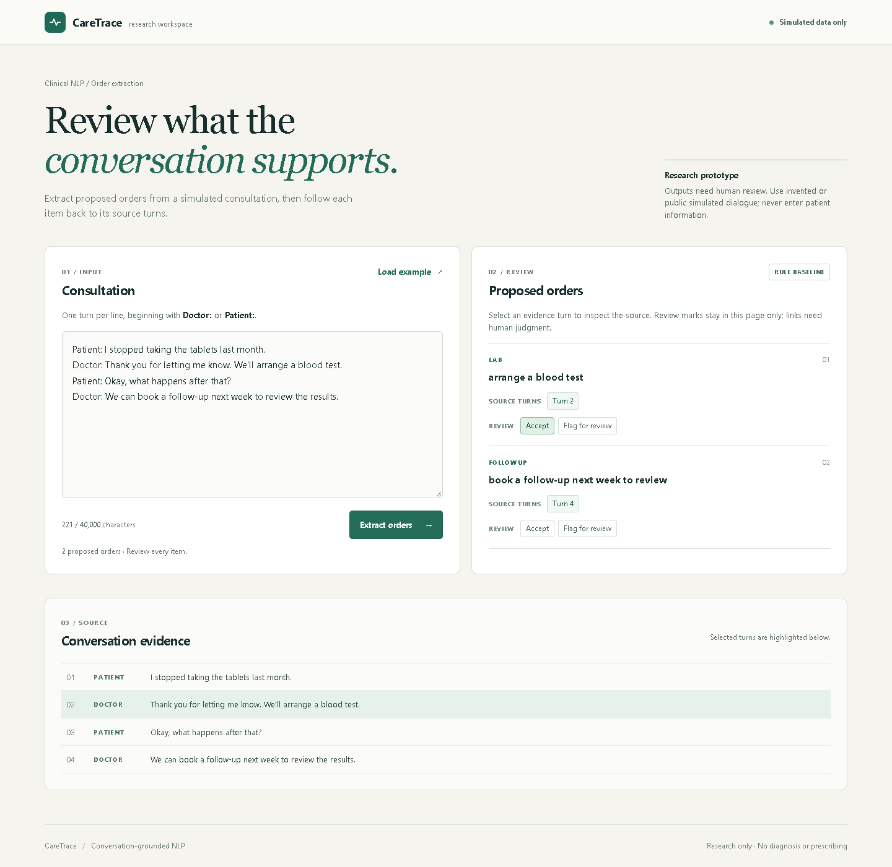

# CareTrace

**A research workspace for extracting proposed orders from simulated clinical conversations and reviewing their source turns.** CareTrace combines a bounded FastAPI service, an evidence review interface, and a reproducible benchmark on simulated consultations.

> **Research prototype:** The default app uses a deliberately limited rule baseline. It is not a clinical device, does not diagnose or prescribe, and has not been validated on real patient encounters. Do not enter patient information.



## What it does

1. Accept a simulated transcript with one clinician or patient turn per line.
2. Extract candidate medication, laboratory, imaging, or follow-up orders using a selected engine.
3. Show the turn IDs supplied as evidence. Missing or unknown IDs are visibly flagged.
4. Mark an item as accepted or flagged in the current browser session. Editing the transcript clears old results so evidence cannot silently become stale.

An evidence link establishes that a referenced turn exists; **it does not establish that the order is correct or supported**. Review marks are ephemeral and are not an audit trail.

## Research question

Can a small language model extract actionable orders and their supporting turns from simulated consultation transcripts more effectively than a transparent rule baseline? The study is inspired by [MEDIQA-OE 2025](https://aclanthology.org/2025.clinicalnlp-1.2/) and uses a pinned [SIMORD mirror](https://huggingface.co/datasets/mkieffer/SIMORD). It is a separate NLP task from [Medical Speech Lab](https://github.com/Stark2028/medical-speech-lab), which studies short-clip speech recognition.

The mirror's advertised train/test split is used with a deterministic validation partition drawn from its training split: **62 train, 19 validation, 90 test1, and 92 test2 encounters**. Test1 and test2 are reserved for evaluation. This split is not the original shared-task split; do not compare its numbers directly with the official leaderboard.

An audit found invalid evidence IDs in **39 of 154 training orders** and **12 of 53 validation orders**. Affected training encounters are excluded from evidence-supervised training. Manual inspection also found an in-range reference pointing to an unrelated turn, so the mirror cannot currently support a trustworthy evidence-accuracy claim. See [data audit](docs/DATA_AUDIT.md) and [methodology](docs/METHODOLOGY.md).

## Run locally

Python 3.12 is recommended. The default rule engine needs no model download or GPU.

```powershell
python -m venv .venv
.\.venv\Scripts\Activate.ps1
python -m pip install -r requirements-dev.txt
python -m unittest discover -s tests -v
uvicorn caretrace.service:app --host 127.0.0.1 --port 8000
```

Open [http://127.0.0.1:8000](http://127.0.0.1:8000), choose **Load example**, and select **Extract orders**. The interface identifies the active engine. API documentation is available at `/docs`.

### API

```bash
curl -X POST http://127.0.0.1:8000/api/v1/extract \
  -H 'Content-Type: application/json' \
  -d '{"transcript":"Patient: I stopped the tablets.\nDoctor: We will arrange a blood test."}'
```

The response contains the engine, candidate orders, evidence turn IDs, an evidence status, and a research-only flag. Requests are limited to 64 KiB and 300 turns; the process handles one extraction at a time. The service does not persist transcripts or review decisions. It is a low-traffic research demo with no authentication or audit log; do not expose it for clinical use.

## Reproduce the experiments

Install a [CUDA-enabled PyTorch build](https://pytorch.org/get-started/locally/) suitable for your machine, then install `requirements-ml.txt`. The pinned model for the partial fine-tuning experiment is [`Qwen/Qwen2.5-0.5B-Instruct`](https://huggingface.co/Qwen/Qwen2.5-0.5B-Instruct) at `7ae557604adf67be50417f59c2c2f167def9a775`. The dataset revision is `a5e570d7512cd36e64b6e4b03d2800ee6fcec86b`.

```bash
python -m pip install -r requirements-ml.txt
python -m caretrace.data --out runs/manifest.json
python -m caretrace.audit --manifest runs/manifest.json --out runs/audit.json
python -m caretrace.evaluate --manifest runs/manifest.json --split validation --engine rules --out runs/rules_validation
python -m caretrace.evaluate --manifest runs/manifest.json --split validation --engine Qwen/Qwen2.5-0.5B-Instruct --out runs/base_validation
python -m caretrace.train --manifest runs/manifest.json --out checkpoints/partial --epochs 1
python -m caretrace.evaluate --manifest runs/manifest.json --split validation --engine checkpoints/partial/model --out runs/tuned_validation
```

Training updates only the final Transformer block and final normalization layer; it is **partial fine-tuning**, not LoRA. It excludes encounters with out-of-range or missing reference evidence and records exclusions, settings, GPU, model revision, and peak memory. Context-length exclusions are also recorded. Run a small smoke check with `--limit 4` first, using a different output directory.

Select and freeze the method using validation only. Then `--split test2 --final-test` scores the full held-out split; `--limit` is prohibited on test splits. The automated score is a **lexical matching proxy**, not clinical accuracy or the official MEDIQA-OE score. Details and results are in [RESULTS.md](RESULTS.md).

To run a local Transformers engine, install both the service and ML dependencies plus PyTorch, then set `CARETRACE_MODEL` to the pinned base model ID or a saved checkpoint directory before starting Uvicorn. The model can produce malformed JSON; those failures are reported, not replaced with invented orders.

An optional local Ollama adapter supports `qwen2.5:3b`. Install the ML dependencies, make that model available to Ollama, start Ollama on loopback, and set `CARETRACE_MODEL=ollama:qwen2.5:3b`. `CARETRACE_OLLAMA_URL` defaults to `http://127.0.0.1:11434` and rejects remote hosts. The adapter checks prompt length using the pinned Qwen tokenizer and asks Ollama for schema-constrained JSON. It records the local model digest during evaluation. Schema compliance and valid turn numbers do **not** guarantee factual correctness. The standard Docker image runs the rule baseline and includes no model weights.

## Container

```bash
docker compose up --build
```

The container listens on `127.0.0.1:8000`, runs as a non-root user with a read-only filesystem, and has a health check and resource limits. For a public demo, add TLS and access controls appropriate to the environment; the in-memory limiter is per process and uses the client address reported by the server. No cloud deployment is configured or implied.

## Repository guide

| Path | Purpose |
| --- | --- |
| `caretrace/contracts.py` | Transcript parsing, response validation, and evidence status |
| `caretrace/engine.py` | Rule baseline and optional local Transformers engine |
| `caretrace/data.py`, `audit.py` | Pinned dataset, split manifest, and evidence audit |
| `caretrace/train.py`, `evaluate.py`, `metrics.py` | Partial fine-tuning and reproducible evaluation |
| `caretrace/service.py`, `web/` | Bounded API and evidence review interface |
| `tests/` | Offline tests for parsing, matching, API limits, and review behavior |
| `docs/` | Data provenance, method, and deployment context |

Downloaded data, checkpoints, caches, and raw model predictions are ignored by Git. This repository does not include source transcripts, patient data, or model weights. See [data provenance](docs/DATA_AUDIT.md) before sharing derived material.
